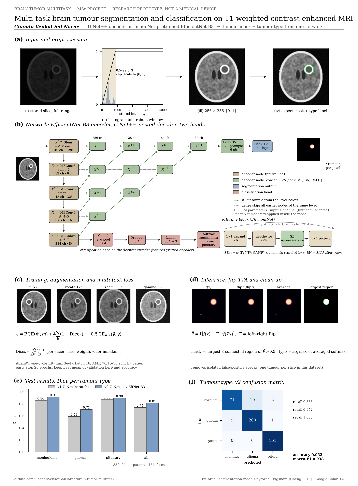
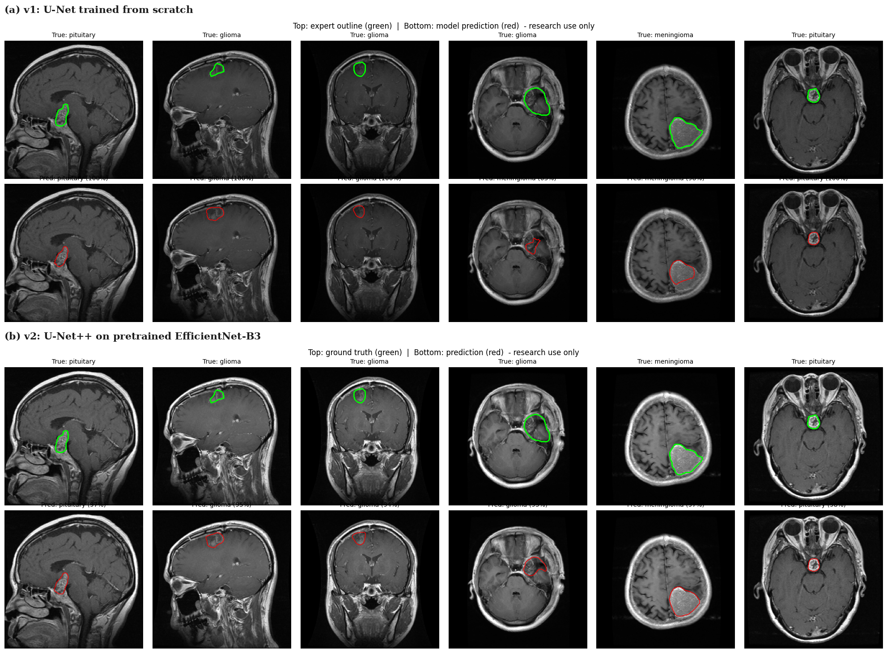

# Brain Tumour Segmentation and Classification (Multi-task U-Net)

One PyTorch model that **outlines the tumour** and **predicts its type** on 2D brain MRI slices.

> ⚠️ Research and education only. Not validated for clinical use.


**Paper-style write-up:** [Word](docs/brain-tumor-multitask_paper.docx) · [PDF](docs/brain-tumor-multitask_paper.pdf). It covers the data, the CNN architecture, training, results v1 vs v2, limitations and usage.



**Same 6 test slices, v1 (top) vs v2 (bottom).** Expert outline in green, model in red:



## Files

| File | Purpose |
|---|---|
| `model.py` | v2 pretrained U-Net++ and v1 multi-task U-Net; checkpoint loading; prediction with flip TTA |
| `data_utils.py` | Loading Figshare `.mat` files or your own images, patient-level split, metrics |
| `train_tumor.py` | Training and test evaluation |
| `colab_train_tumor.ipynb` | Run everything in Google Colab |
| `setup_windows.ps1` | One-time Windows setup (virtual environment + PyTorch with GPU) |
| `.vscode/` | Ready-made VS Code run configurations |

## Models

Two models, chosen with `--arch`:

**v2 (default): U-Net++ on a pretrained EfficientNet-B3** (`--arch unetplusplus --encoder efficientnet-b3`)

| Part | Details |
|---|---|
| Input | 1 × 256 × 256 MRI slice, robust 0.5–99.5 percentile scaling, then ImageNet mean/std |
| Encoder | EfficientNet-B3 pretrained on ImageNet (first layer adapted to 1 channel) |
| Segmentation decoder | U-Net++: nested, densely connected skip paths → 1 × 1 conv → tumour mask |
| Classification head | Global average pool on the deepest encoder features → dropout 0.4 → linear 3 |
| Mask loss | BCE + **per-slice** soft Dice (the same way the test Dice is measured) |
| Type loss | Cross-entropy with class weights (meningioma is the smallest class) and label smoothing 0.05; weight 0.5 |
| Prediction | Average of the slice and its mirror image (test-time augmentation); keep the largest tumour region |
| Parameters | 13.63 M |

**v1 (baseline): multi-task U-Net trained from scratch** (`--arch unet`)

| Part | Details |
|---|---|
| Shared encoder | 4 conv blocks (2 × [3×3 conv → BatchNorm → ReLU]) with 2×2 max-pool; 32 → 256 channels |
| Bottleneck | Conv block, 512 channels at 16 × 16, dropout 0.3 |
| Segmentation head | 4 × [2×2 transposed conv → concat skip → conv block] → 1×1 conv → tumour mask |
| Classification head | Global average pool → linear 128 + ReLU → dropout 0.4 → linear 3 |
| Parameters | ≈ 7.83 M |

## Data

**Jun Cheng's Figshare brain tumour dataset** (CC BY 4.0): 3,064 T1-weighted contrast-enhanced slices from 233 patients, each with a radiologist-drawn tumour mask, tumour type and patient ID: meningioma (708), glioma (1,426), pituitary (930).

Download: <https://doi.org/10.6084/m9.figshare.1512427>. Unzip anywhere; the script searches subfolders and skips `cvind.mat`. Every slice contains a tumour, so there is **no "no tumour" class**.

Own data: image and mask folders with matching filenames plus `labels.csv` (`filename,label,patient_id`).

## Run in VS Code (Windows)

1. **Clone:** `Ctrl+Shift+P` → *Git: Clone* → this repo, then open the folder. Install the recommended extensions when VS Code asks.
2. **Set up (once):** open a terminal (`Ctrl+'`) and run
   ```powershell
   powershell -ExecutionPolicy Bypass -File setup_windows.ps1
   ```
   This creates `.venv`, installs PyTorch with NVIDIA GPU support and the other packages, and prints whether the GPU is found.
3. **Select the environment:** `Ctrl+Shift+P` → *Python: Select Interpreter* → `.venv`.
4. **Run:** open the **Run and Debug** panel (`Ctrl+Shift+D`), pick a configuration, press **F5**:
   - *1. Quick test (2 epochs)*: check everything works first
   - *2. Full training*
   - *3. Full training (batch 4)*: if you get a GPU "out of memory" error

The run configurations read the data from `Downloads\1512427`. If yours is elsewhere, change the path in `.vscode/launch.json`.

Or run from the terminal:

```powershell
python train_tumor.py --figshare-dir "$HOME\Downloads\1512427" --out test_run --epochs 2
python train_tumor.py --figshare-dir "$HOME\Downloads\1512427" --out models
```

## Run in Google Colab

Open `colab_train_tumor.ipynb` in Colab (*File → Open notebook → GitHub*, tick *Include private repos*), choose **Runtime → T4 GPU**, and run the cells in order. While the repo is private, add a read-only GitHub token as a Colab secret named `GITHUB_TOKEN`.

## Training settings (v2)

| Setting | Value |
|---|---|
| Split | **70 / 15 / 15 by patient**: no patient appears in more than one split (same split as v1) |
| Optimiser | AdamW, one-cycle learning rate up to 3e-4, weight decay 1e-4, gradient clipping |
| Epochs | Up to 80, early stopping after 20 epochs without improvement |
| Model selection | Best average of validation Dice and validation accuracy |
| Batch size | 16 |
| Augmentation | Flip; rotation ±15°; zoom 0.85–1.15; shift ±8 %; gamma; brightness and contrast; light noise |
| Mixed precision | On when a GPU is used |
| Seed | 42 |

v1 used Adam 1e-4, batch 8, flips plus brightness/contrast only, and selection by validation loss.

## Outputs (in `--out`, default `models/`)

- `unet_tumor_multitask_best.pt`: best model (by validation loss) and class names
- `history_tumor.csv`: loss, Dice and accuracy per epoch
- `test_results_tumor.json`: **test** Dice (overall and per type), accuracy, macro-F1, confusion matrix, test patient IDs

## Results: v2 vs v1 (same held-out test set)

Both models are tested on the **same 35 patients (454 slices)**, which neither model saw during training or model selection.

| Metric | v1: U-Net from scratch | **v2: U-Net++ / EfficientNet-B3** | Change |
|---|---|---|---|
| Tumour mask Dice (mean ± SD) | 0.740 ± 0.294 | **0.811 ± 0.232** | +0.071 |
| Dice, meningioma | 0.858 | **0.913** | +0.055 |
| Dice, glioma | 0.590 | **0.707** | +0.117 |
| Dice, pituitary | 0.875 | **0.895** | +0.020 |
| Type accuracy | 0.938 | **0.952** | +0.014 |
| Type macro-F1 | 0.923 | **0.938** | +0.015 |
| Parameters | 7.83 M | 13.63 M | |

v2 confusion matrix (rows = true type, columns = predicted type):

| | Meningioma | Glioma | Pituitary | Recall |
|---|---|---|---|---|
| **Meningioma** | 71 | 10 | 2 | 0.855 |
| **Glioma** | 9 | 200 | 1 | 0.952 |
| **Pituitary** | 0 | 0 | 161 | 1.000 |
| **Precision** | 0.888 | 0.952 | 0.982 | |

What changed the result:
- **The largest gain is on glioma outlines** (+0.12 Dice). The pretrained encoder and stronger augmentation help most on the irregular, poorly defined edges of gliomas.
- **The spread of per-slice Dice narrowed** (SD 0.29 → 0.23), so there are fewer near-total misses.
- **All pituitary slices are now correctly typed.** Meningioma vs glioma remains the main confusion (19 of 22 errors).
- **This is one split of 35 patients,** so differences of about 1–2 points in accuracy are within the uncertainty. Patient-level 5-fold cross-validation is the next step.

## Results: v1 baseline in detail (held-out test set)

Trained on a Colab T4 GPU (about 27 s per epoch). Early stopping fired at epoch 82, and the best model is the one with the lowest validation loss. Test set: **35 patients, 454 slices**, none of them seen in training or validation.

| | Overall | Meningioma | Glioma | Pituitary |
|---|---|---|---|---|
| Tumour mask Dice | **0.740** ± 0.294 | 0.858 | 0.590 | 0.875 |
| Type recall (sensitivity) | | 0.855 (71/83) | 0.933 (196/210) | 0.988 (159/161) |
| Type precision | | 0.826 (71/86) | 0.942 (196/208) | 0.994 (159/160) |

Type accuracy **0.938**, macro-F1 **0.923**.

Confusion matrix (rows = true type, columns = predicted type):

| | Meningioma | Glioma | Pituitary |
|---|---|---|---|
| **Meningioma** | 71 | 12 | 0 |
| **Glioma** | 13 | 196 | 1 |
| **Pituitary** | 2 | 0 | 159 |

What this shows:
- **Pituitary** tumours are almost always recognised. They sit in a fixed place (the sella) and have a compact shape.
- Most errors are **meningioma vs glioma** (25 of 28 misclassified slices).
- **Glioma outlines are the hardest** (Dice 0.59). Gliomas grow into the surrounding brain and have unclear edges on T1-contrast MRI, so the expert outline itself is harder to reproduce.
- The large spread (± 0.29) comes from small tumour areas on edge slices, where a few pixels of error give a very low Dice.
- Training Dice reached 0.94 while test Dice is 0.74, so outline quality is limited by overfitting on about 2,150 training slices. v2 (pretrained encoder, stronger augmentation, per-slice Dice loss) was built to close this gap; see the comparison above.

## Note on results

Many papers on this dataset report very high accuracy after splitting **by slice**, so slices from one patient appear in both training and test sets. This project splits **by patient**, so scores are likely lower but give a fairer estimate for new patients.

## Citation

Cheng, J. (2017). *Brain tumor dataset*. Figshare. https://doi.org/10.6084/m9.figshare.1512427

Cheng, J. et al. (2015). Enhanced performance of brain tumor classification via tumor region augmentation and partition. *PLoS ONE* 10(10).
